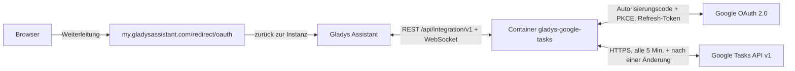
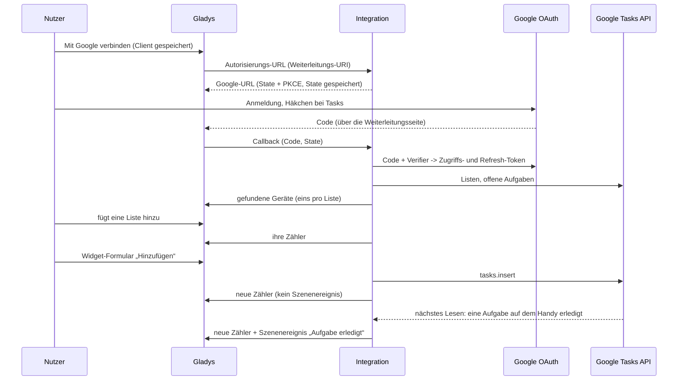
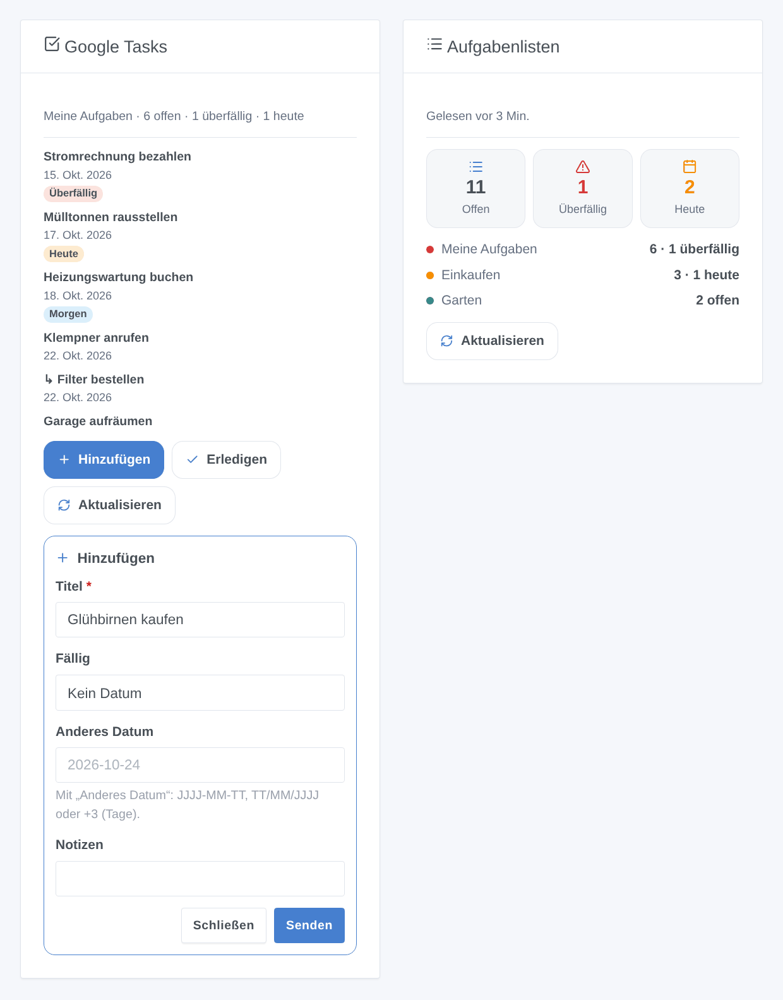

# Gladys Google Tasks

[English](README.md) · [Français](README.fr.md) · **Deutsch** · [Español](README.es.md)

[](LICENSE)
[](https://github.com/William-De71/gladys-google-tasks/releases)
[](https://github.com/William-De71/gladys-google-tasks/actions/workflows/release.yml)
[](https://gladysassistant.com)


Externe Integration für [Gladys Assistant](https://gladysassistant.com) zu **Google Tasks**: Deine Aufgabenlisten werden zu Geräten mit Zählern, ein Dashboard-Widget zeigt die Aufgaben und lässt dich welche hinzufügen oder erledigen, und Szenen reagieren auf neue, erledigte, fällige oder überfällige Aufgaben. Sie nutzt die offizielle Google Tasks API mit deinem eigenen Google-Cloud-OAuth-Client.

Benutzerdokumentation: [English](docs/en.md) · [Français](docs/fr.md) · [Deutsch](docs/de.md) · [Español](docs/es.md).

> Community-Integration, nicht mit Google verbunden und nicht von Google unterstützt.

## Funktionen

- Ein **Gerät pro Aufgabenliste** mit drei schreibgeschützten Zählern: offene, überfällige und heute fällige Aufgaben (in der Zeitzone von Gladys).
- **4 Szenenauslöser**, **4 Szenenaktionen** und **2 Dashboard-Widgets** mit den Formularen „Hinzufügen“ und „Erledigen“ (siehe unten).
- **OAuth 2.0** mit deinem eigenen Google-Cloud-Client: minimaler Scope `tasks`, PKCE, State bleibt über einen Neustart erhalten, widerrufener Zugriff wird gemeldet, ohne Google zu bombardieren.
- **Regelmäßiges Lesen** (Google Tasks hat keine Push-API): standardmäßig alle 5 Minuten, nur die Änderungen seit dem letzten Lesen, und direkt nach einer Änderung aus Gladys.
- Vier Sprachen überall: Englisch, Französisch, Deutsch, Spanisch.

## Funktionsweise






### Transport

`transports: ["cloud"]`: Alles läuft über die Server von Google; deine Aufgaben werden nur zwischen Google und deinem Gladys übertragen. Die Listengeräte tragen das Cloud-Badge und ein „nicht erreichbar“-Badge, sobald Google den Zugriff widerrufen hat.

## Geräte und Funktionen

| Funktion               | Kategorie / Typ              | Wert                                              |
| ---------------------- | ---------------------------- | ------------------------------------------------- |
| Offene Aufgaben        | `counter-sensor` / `integer` | Nicht erledigte Aufgaben, Unteraufgaben inklusive |
| Überfällige Aufgaben   | `counter-sensor` / `integer` | Offene Aufgaben, deren Fälligkeit vorbei ist      |
| Heute fällige Aufgaben | `counter-sensor` / `integer` | Offene Aufgaben, die heute fällig sind            |

## Szenenauslöser, -aktionen und Widgets



- Auslöser (nach Liste filterbar): **Aufgabe hinzugefügt**, **Aufgabe erledigt** (außerhalb von Gladys), **Aufgabe heute fällig** (zu einer einstellbaren Stunde: Google speichert keine Uhrzeit), **Aufgabe überfällig** (nach Mitternacht).
- Aktionen: **Aufgabe hinzufügen** (Liste, Titel, Notizen, Fälligkeit), **Aufgabe erledigen** anhand ihres Titels, **Aufgaben lesen** (Anzahl, überfällig, heute, Titel, Zusammenfassung, nächste Aufgabe), **erledigte Aufgaben löschen**. Sie starten nie im Gegenzug eine Szene.
- Widgets: **Google Tasks** (die Aufgaben einer Liste, Badges, Notizen und Link, Hinzufügen / Erledigen / Aktualisieren) und **Aufgabenlisten** (Summen und eine Zeile pro Liste).
- Beispiele: jeden Morgen die heute fälligen oder überfälligen Aufgaben lesen und die Zusammenfassung senden; wenn eine Aufgabe zu „Einkaufen“ hinzugefügt wird, den Haushalt benachrichtigen; wenn eine Aufgabe überfällig wird, die Büro-LED rot schalten.

Nicht umgesetzt: Bearbeiten, Verschieben (`tasks.move`) oder Löschen einer Aufgabe, Anlegen von Unteraufgaben oder Listen (auf einem Dashboard selten nötig, und jedes würde Formulare für wenig Nutzen hinzufügen); eine Uhrzeit für Aufgaben (die API liefert nur das Datum).

## Voraussetzungen

- Gladys **5.3.0** oder neuer (ältere Versionen können die Integration nicht installieren: Widget-Formulare, Widgets und Szenen, Katalog-Schlagwörter von Gladys 5.3).
- Ein Google-Konto, das Google Tasks nutzt.
- Ein kostenloses Google-Cloud-Projekt mit aktivierter Google Tasks API, einem Zustimmungsbildschirm **In Produktion** und einem OAuth-Client vom Typ **Webanwendung** mit der Weiterleitungs-URI `https://my.gladysassistant.com/redirect/oauth` (Schritt für Schritt in der [Dokumentation](docs/de.md#konfiguration)).

## Installation

- **Aus dem Store**: Integrationen → Google Tasks → Installieren.
- **Über die Repository-URL**: Integrationen → Externe Integration hinzufügen → `https://github.com/William-De71/gladys-google-tasks`.
- **Entwicklermodus**: `npm install`, dann neben einem Gladys im Entwicklermodus mit den Variablen unten starten.

## Konfiguration

| Feld                                   | Standard    | Zweck                                              |
| -------------------------------------- | ----------- | -------------------------------------------------- |
| Client-ID                              | —           | Dein OAuth-Client (`….apps.googleusercontent.com`) |
| Clientschlüssel                        | —           | Sein Schlüssel (`GOCSPX-…`)                        |
| Mit Google verbinden                   | —           | OAuth-2.0-Anmeldung (nur Scope `tasks`)            |
| Google Tasks lesen alle (Minuten)      | 5           | 1 bis 60; jedes Mal 1 Anfrage + 1 pro Liste        |
| Uhrzeit des Auslösers „Aufgabe fällig“ | 8           | 0 bis 23                                           |
| Sprache der Texte                      | Automatisch | Funktionsnamen, Szenenzusammenfassungen            |

Konfigurationsaktionen: **Verbindung testen**, **Listen neu lesen**, **Diagnose** (anonymisierte Zusammenfassung in den Protokollen), **Von Google trennen** (widerruft den Zugriff bei Google).

## Verwendung

Speichere Client-ID und Schlüssel, klicke auf **Mit Google verbinden**, akzeptiere die Warnung „nicht überprüfte App“ (es ist deine eigene) und setze das Häkchen bei Tasks, dann füge die Listen über die **Geräteerkennung** und die Widgets zu einem Dashboard hinzu.

## Entwicklung

```bash
npm install
npm test                     # node --test, berührt nie das Netzwerk
npm run lint && npm run format:check
npx github:GladysAssistant/integration-store . --skip-image-check
docs/illustrations/render.sh # Widget-Illustrationen
scripts/build-cover.sh       # cover.jpg
```

Umgebungsvariablen (vom Gladys-Supervisor gesetzt): `GLADYS_HOST_API_URL`, `GLADYS_INTEGRATION_TOKEN`, `GLADYS_INTEGRATION_SELECTOR` und `TZ` (die Zeitzone von Gladys: „heute“ und „überfällig“ richten sich danach). Die Integration schreibt nichts nach `/data`: Die Token liegen in der Gladys-Konfiguration.

## Release-Prozess


Jeder Merge auf `main` startet die CI und berechnet dann die Version aus den [Conventional Commits](https://www.conventionalcommits.org/) seit dem letzten Tag: `feat` → Minor, `fix` / `perf` → Patch, `!` oder `BREAKING CHANGE` → Major (ein Minor unter 1.0.0); `docs`, `chore`, `ci`, `test`, `style`, `refactor`, `build` allein veröffentlichen nichts. Ohne Tag wird 0.1.0 unverändert veröffentlicht. Der Changelog-Abschnitt wird erzeugt, der Tag gepusht, das Multi-Architektur-Image gebaut, dann erhält `main` den Release-Commit (der Store sieht also nie eine Version ohne Image), das GitHub Release wird erstellt und ein letzter Job prüft das öffentliche Image, den Store-Validator und das Topic.

- Der Titel des Pull Requests wird zum Squash-Commit und dann zur Changelog-Zeile: Schreibe ihn auf Englisch, für die Nutzer (`pr-title.yml` prüft ihn). Bearbeite `CHANGELOG.md` nie von Hand.
- 1.0.0 ist eine Entscheidung: Actions → Release → Run workflow mit `release-as: 1.0.0`. `dry-run` zeigt Version und Notizen, ohne etwas zu veröffentlichen.
- **Geschützter Branch**: Das Release pusht seinen Commit mit `GITHUB_TOKEN` auf `main`. Mit einem Ruleset auf `main` füge GitHub Actions zur Bypass-Liste hinzu (oder pushe über eine GitHub App), sonst schlägt der Publish-Job fehl.
- Nach dem ersten Release muss das `ghcr.io`-Paket öffentlich sein (Package settings → Change visibility).

## Fehlerbehebung

Siehe [docs/de.md](docs/de.md#fehlerbehebung) (Weiterleitungs-URI, App im Test geblieben, Berechtigung nicht angehakt, API nicht aktiviert, Zeitzone). Melde Probleme mit den Versionen von Gladys und der Integration, deiner Google-Cloud-Einrichtung und der Ausgabe der Schaltfläche **Diagnose** (Einstellungen → Supervision).

## Mitwirken

Issues und Pull Requests sind willkommen. Führe `npm run format:check && npm run lint && npm test` aus, bevor du einen Pull Request öffnest, und ändere keine externe ID und keinen gespeicherten Schlüssel (siehe [CLAUDE.md](CLAUDE.md)).

## Sicherheit

Siehe [SECURITY.md](SECURITY.md): Melde Schwachstellen vertraulich. Der Clientschlüssel ist ein `secret`-Feld; die Token liegen in der Gladys-Konfiguration (außerhalb des Formulars) und werden nie protokolliert; die Diagnose schreibt weder Token noch Aufgabentitel.

## Screenshots folgen

Die Bilder oben sind Illustrationen, keine Screenshots. Echte Screenshots kommen nach `docs/assets/screenshots/` (PNG, 1280 × 800): `configuration.png`, `google-consent.png`, `discovery.png`, `device.png`.

## Lizenz

[Apache-Lizenz 2.0](LICENSE) — siehe auch [NOTICE](NOTICE). Google Tasks ist eine Marke von Google LLC; diese Community-Integration ist nicht mit Google verbunden. Danke an die Dokumentation und das SDK von Gladys.
