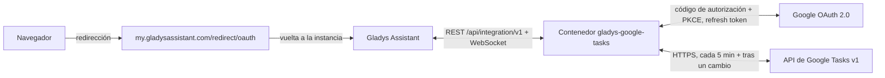
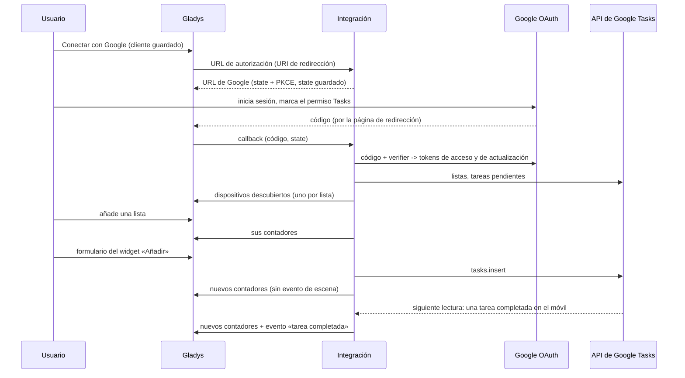
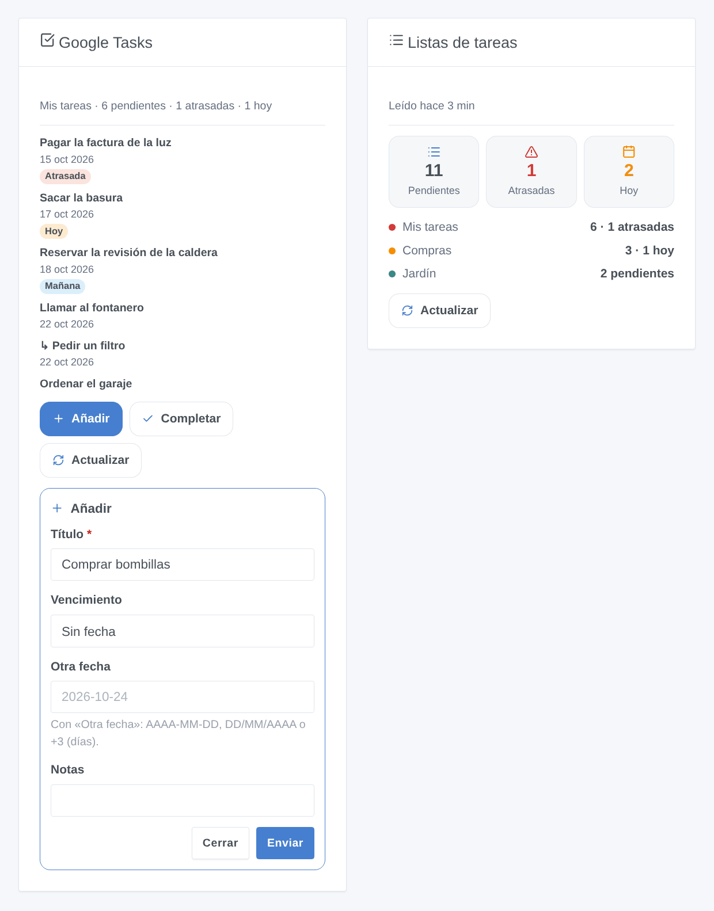

# Gladys Google Tasks

[English](README.md) · [Français](README.fr.md) · [Deutsch](README.de.md) · **Español**

[](LICENSE)
[](https://github.com/William-De71/gladys-google-tasks/releases)
[](https://github.com/William-De71/gladys-google-tasks/actions/workflows/release.yml)
[](https://gladysassistant.com)


Integración externa de [Gladys Assistant](https://gladysassistant.com) para **Google Tasks**: tus listas de tareas se convierten en dispositivos con contadores, un widget del panel muestra las tareas y permite añadir o completar una, y las escenas reaccionan a las tareas añadidas, completadas, que vencen o atrasadas. Usa la API oficial de Google Tasks con tu propio cliente OAuth de Google Cloud.

Documentación de usuario: [English](docs/en.md) · [Français](docs/fr.md) · [Deutsch](docs/de.md) · [Español](docs/es.md).

> Integración comunitaria, sin relación con Google ni respaldada por Google.

## Funciones

- Un **dispositivo por lista de tareas** con tres contadores de solo lectura: tareas pendientes, atrasadas y para hoy (en la zona horaria de Gladys).
- **4 activadores de escena**, **4 acciones de escena** y **2 widgets** con los formularios «Añadir» y «Completar» (abajo).
- **OAuth 2.0** con tu propio cliente de Google Cloud: scope mínimo `tasks`, PKCE, state conservado tras un reinicio, acceso revocado señalado sin saturar a Google.
- **Lectura periódica** (Google Tasks no tiene API push): cada 5 minutos por defecto, solo los cambios desde la lectura anterior, y justo después de un cambio hecho desde Gladys.
- Cuatro idiomas en todas partes: inglés, francés, alemán, español.

## Funcionamiento






### Transporte

`transports: ["cloud"]`: todo pasa por los servidores de Google; tus tareas solo viajan entre Google y tu Gladys. Los dispositivos de las listas llevan la insignia nube, y una insignia «inaccesible» en cuanto Google revoca el acceso.

## Dispositivos y funciones

| Función           | Categoría / tipo             | Valor                                      |
| ----------------- | ---------------------------- | ------------------------------------------ |
| Tareas pendientes | `counter-sensor` / `integer` | Tareas no completadas, subtareas incluidas |
| Tareas atrasadas  | `counter-sensor` / `integer` | Tareas pendientes cuyo vencimiento ya pasó |
| Tareas para hoy   | `counter-sensor` / `integer` | Tareas pendientes que vencen hoy           |

## Activadores, acciones de escena y widgets



- Activadores (filtrables por lista): **tarea añadida**, **tarea completada** (fuera de Gladys), **tarea vence hoy** (a una hora ajustable: Google no guarda la hora), **tarea atrasada** (después de medianoche).
- Acciones: **añadir una tarea** (lista, título, notas, vencimiento), **completar una tarea** por su título, **leer las tareas** (número, atrasadas, hoy, títulos, resumen, próxima tarea), **borrar tareas completadas**. Nunca lanzan una escena a cambio.
- Widgets: **Google Tasks** (las tareas de una lista, insignias, notas y enlace, Añadir / Completar / Actualizar) y **Listas de tareas** (totales y una fila por lista).
- Ejemplos: cada mañana, leer las tareas para hoy o atrasadas y enviar el resumen; cuando se añade una tarea a «Compras», avisar al hogar; cuando una tarea pasa a atrasada, poner en rojo el LED del despacho.

No implementado: editar, mover (`tasks.move`) o eliminar una tarea, crear subtareas o listas (poco útil en un panel, y cada caso añadiría formularios); la hora de una tarea (la API solo expone la fecha).

## Requisitos

- Gladys **5.3.0** o posterior (las versiones anteriores no pueden instalar la integración: formularios de los widgets, widgets y escenas, palabras clave del catálogo de Gladys 5.3).
- Una cuenta de Google que use Google Tasks.
- Un proyecto gratuito de Google Cloud con la API de Google Tasks habilitada, una pantalla de consentimiento **En producción** y un cliente OAuth de tipo **Aplicación web** cuyo URI de redireccionamiento sea `https://my.gladysassistant.com/redirect/oauth` (paso a paso en la [documentación](docs/es.md#configuración)).

## Instalación

- **Desde la tienda**: Integraciones → Google Tasks → Instalar.
- **Desde la URL del repositorio**: Integraciones → Añadir una integración externa → `https://github.com/William-De71/gladys-google-tasks`.
- **Modo desarrollador**: `npm install` y luego ejecútala junto a un Gladys en modo desarrollador con las variables de abajo.

## Configuración

| Campo                            | Por defecto | Función                                           |
| -------------------------------- | ----------- | ------------------------------------------------- |
| Client ID                        | —           | Tu cliente OAuth (`….apps.googleusercontent.com`) |
| Client secret                    | —           | Su secreto (`GOCSPX-…`)                           |
| Conectar con Google              | —           | Conexión OAuth 2.0 (solo scope `tasks`)           |
| Leer Google Tasks cada (minutos) | 5           | 1 a 60; 1 solicitud + 1 por lista cada vez        |
| Hora del activador «tarea vence» | 8           | 0 a 23                                            |
| Idioma de los textos             | Automático  | Nombres de funciones, resúmenes de escenas        |

Acciones de configuración: **Probar la conexión**, **Volver a leer las listas**, **Diagnóstico** (resumen anonimizado en los registros), **Desconectar de Google** (revoca el acceso en Google).

## Uso

Guarda el Client ID y el secreto, pulsa **Conectar con Google**, acepta el aviso «aplicación no verificada» (es la tuya) y marca el permiso de Tasks; luego añade las listas desde **Descubrimiento** y los widgets a un panel.

## Desarrollo

```bash
npm install
npm test                     # node --test, nunca toca la red
npm run lint && npm run format:check
npx github:GladysAssistant/integration-store . --skip-image-check
docs/illustrations/render.sh # ilustraciones de los widgets
scripts/build-cover.sh       # cover.jpg
```

Variables de entorno (las define el supervisor de Gladys): `GLADYS_HOST_API_URL`, `GLADYS_INTEGRATION_TOKEN`, `GLADYS_INTEGRATION_SELECTOR` y `TZ` (la zona horaria de Gladys: «hoy» y «atrasada» la siguen). La integración no escribe nada en `/data`: los tokens están en la configuración de Gladys.

## Proceso de publicación


Cada fusión en `main` lanza la CI y luego calcula la versión a partir de los [Conventional Commits](https://www.conventionalcommits.org/) desde la última etiqueta: `feat` → menor, `fix` / `perf` → parche, `!` o `BREAKING CHANGE` → mayor (una menor mientras sea < 1.0.0); `docs`, `chore`, `ci`, `test`, `style`, `refactor`, `build` solos no publican nada. Sin etiqueta, la 0.1.0 se publica tal cual. Se genera la sección del changelog, se sube la etiqueta, se construye la imagen multiarquitectura, luego `main` recibe el commit de publicación (la tienda nunca ve una versión sin su imagen), se crea la GitHub Release y un último job comprueba la imagen pública, el validador de la tienda y el topic.

- El título de la pull request se convierte en el commit squash y luego en la línea del changelog: escríbelo en inglés, para el usuario (`pr-title.yml` lo comprueba). Nunca edites `CHANGELOG.md` a mano.
- La 1.0.0 es una decisión: Actions → Release → Run workflow con `release-as: 1.0.0`. `dry-run` muestra la versión y las notas sin publicar nada.
- **Rama protegida**: la publicación sube su commit a `main` con `GITHUB_TOKEN`. Con un ruleset en `main`, añade GitHub Actions a su lista de omisión (o pasa por una GitHub App); si no, el job de publicación falla.
- Tras la primera publicación, el paquete `ghcr.io` debe ser público (Package settings → Change visibility).

## Solución de problemas

Ver [docs/es.md](docs/es.md#solución-de-problemas) (URI de redireccionamiento, aplicación en prueba, permiso sin marcar, API no habilitada, zona horaria). Informa de los problemas con las versiones de Gladys y de la integración, tu configuración de Google Cloud y la salida del botón **Diagnóstico** (Ajustes → Supervisión).

## Contribuir

Las issues y pull requests son bienvenidas. Ejecuta `npm run format:check && npm run lint && npm test` antes de abrir una pull request, y no cambies ningún identificador externo ni clave guardada (ver [CLAUDE.md](CLAUDE.md)).

## Seguridad

Ver [SECURITY.md](SECURITY.md): informa de las vulnerabilidades en privado. El Client secret es un campo `secret`; los tokens están en la configuración de Gladys (fuera del formulario) y nunca se escriben en los registros; el Diagnóstico no escribe ni tokens ni títulos de tareas.

## Capturas pendientes

Las imágenes de arriba son ilustraciones, no capturas. Las capturas reales irán en `docs/assets/screenshots/` (PNG, 1280 × 800): `configuration.png`, `google-consent.png`, `discovery.png`, `device.png`.

## Licencia

[Licencia Apache 2.0](LICENSE) — ver también [NOTICE](NOTICE). Google Tasks es una marca de Google LLC; esta integración comunitaria no está afiliada a ella. Gracias a la documentación y al SDK de Gladys.
