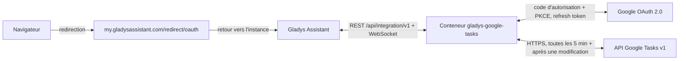
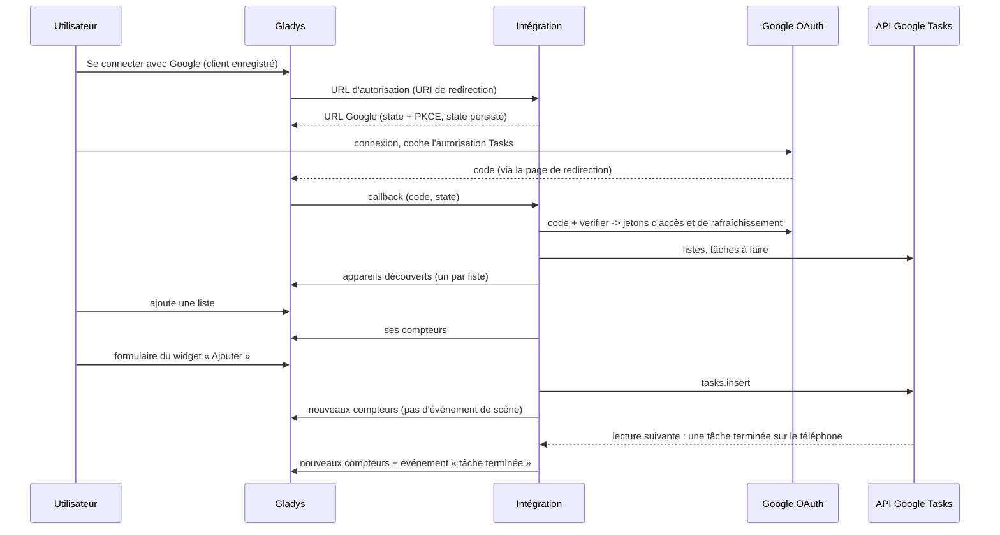
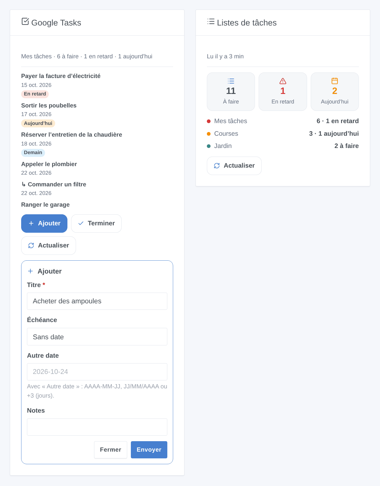

# Gladys Google Tasks

[English](README.md) · **Français** · [Deutsch](README.de.md) · [Español](README.es.md)

[](LICENSE)
[](https://github.com/William-De71/gladys-google-tasks/releases)
[](https://github.com/William-De71/gladys-google-tasks/actions/workflows/release.yml)
[](https://gladysassistant.com)


Intégration externe [Gladys Assistant](https://gladysassistant.com) pour **Google Tasks** : vos listes de tâches deviennent des appareils avec compteurs, un widget du tableau de bord affiche les tâches et permet d’en ajouter ou d’en terminer, et des scènes réagissent aux tâches ajoutées, terminées, arrivées à échéance ou en retard. Elle utilise l’API officielle Google Tasks avec votre propre client OAuth Google Cloud.

Documentation utilisateur : [English](docs/en.md) · [Français](docs/fr.md) · [Deutsch](docs/de.md) · [Español](docs/es.md).

> Intégration communautaire, sans lien avec Google ni approuvée par Google.

## Fonctionnalités

- Un **appareil par liste de tâches** avec trois compteurs en lecture seule : tâches à faire, en retard, pour aujourd’hui (dans le fuseau horaire de Gladys).
- **4 déclencheurs de scène**, **4 actions de scène** et **2 widgets** avec formulaires « Ajouter » et « Terminer » (ci-dessous).
- **OAuth 2.0** avec votre propre client Google Cloud : scope minimal `tasks`, PKCE, state conservé après un redémarrage, accès révoqué signalé sans marteler Google.
- **Lecture périodique** (Google Tasks n’a pas d’API push) : toutes les 5 minutes par défaut, uniquement les changements depuis la lecture précédente, et juste après une modification faite depuis Gladys.
- Quatre langues partout : anglais, français, allemand, espagnol.

## Fonctionnement






### Transport

`transports: ["cloud"]` : tout passe par les serveurs de Google ; vos tâches ne circulent qu’entre Google et votre Gladys. Les appareils des listes portent le badge cloud, et un badge « injoignable » dès que Google a révoqué l’accès.

## Appareils et fonctionnalités

| Fonctionnalité          | Catégorie / type             | Valeur                                         |
| ----------------------- | ---------------------------- | ---------------------------------------------- |
| Tâches à faire          | `counter-sensor` / `integer` | Tâches non terminées, sous-tâches comprises    |
| Tâches en retard        | `counter-sensor` / `integer` | Tâches à faire dont l’échéance est passée      |
| Tâches pour aujourd’hui | `counter-sensor` / `integer` | Tâches à faire dont l’échéance est aujourd’hui |

## Déclencheurs, actions de scène et widgets



- Déclencheurs (filtrables par liste) : **tâche ajoutée**, **tâche terminée** (hors Gladys), **tâche à échéance** (à une heure réglable : Google n’enregistre pas d’heure), **tâche en retard** (après minuit).
- Actions : **ajouter une tâche** (liste, titre, notes, échéance), **terminer une tâche** par son titre, **lire les tâches** (nombre, en retard, aujourd’hui, titres, résumé, prochaine tâche), **effacer les tâches terminées**. Elles ne déclenchent jamais de scène en retour.
- Widgets : **Google Tasks** (les tâches d’une liste, badges, notes et lien, Ajouter / Terminer / Actualiser) et **Listes de tâches** (totaux et une ligne par liste).
- Exemples : chaque matin, lire les tâches du jour ou en retard et envoyer le résumé ; quand une tâche est ajoutée à « Courses », prévenir le foyer ; quand une tâche passe en retard, allumer la LED du bureau en rouge.

Non implémenté : modifier, déplacer (`tasks.move`) ou supprimer une tâche, créer des sous-tâches ou des listes (rarement utile sur un tableau de bord, et chaque cas ajouterait des formulaires) ; l’heure d’une tâche (l’API n’expose que la date).

## Prérequis

- Gladys **5.3.0** ou plus récent (les versions antérieures ne peuvent pas installer l’intégration : formulaires des widgets, widgets et scènes, mots-clés du catalogue de Gladys 5.3).
- Un compte Google qui utilise Google Tasks.
- Un projet Google Cloud gratuit avec l’API Google Tasks activée, un écran de consentement **En production** et un client OAuth de type **Application Web** dont l’URI de redirection est `https://my.gladysassistant.com/redirect/oauth` (pas à pas dans la [documentation](docs/fr.md#configuration)).

## Installation

- **Depuis le store** : Intégrations → Google Tasks → Installer.
- **Depuis l’URL du dépôt** : Intégrations → Ajouter une intégration externe → `https://github.com/William-De71/gladys-google-tasks`.
- **Mode développeur** : `npm install`, puis lancez-la à côté d’un Gladys en mode développeur avec les variables ci-dessous.

## Configuration

| Champ                                     | Par défaut  | Rôle                                                |
| ----------------------------------------- | ----------- | --------------------------------------------------- |
| Client ID                                 | —           | Votre client OAuth (`….apps.googleusercontent.com`) |
| Client secret                             | —           | Son code secret (`GOCSPX-…`)                        |
| Se connecter avec Google                  | —           | Connexion OAuth 2.0 (scope `tasks` seulement)       |
| Lire Google Tasks toutes les (minutes)    | 5           | 1 à 60 ; 1 requête + 1 par liste à chaque fois      |
| Heure du déclencheur « tâche à échéance » | 8           | 0 à 23                                              |
| Langue des textes                         | Automatique | Noms des fonctionnalités, résumés des scènes        |

Actions de configuration : **Tester la connexion**, **Relire les listes**, **Diagnostic** (résumé anonymisé dans les journaux), **Se déconnecter de Google** (révoque l’accès chez Google).

## Utilisation

Enregistrez le Client ID et le secret, cliquez sur **Se connecter avec Google**, acceptez l’avertissement « application non validée » (c’est la vôtre) et cochez l’autorisation Tasks, puis ajoutez les listes depuis la **Découverte** et les widgets à un tableau de bord.

## Développement

```bash
npm install
npm test                     # node --test, ne touche jamais le réseau
npm run lint && npm run format:check
npx github:GladysAssistant/integration-store . --skip-image-check
docs/illustrations/render.sh # illustrations des widgets
scripts/build-cover.sh       # cover.jpg
```

Variables d’environnement (fournies par le superviseur de Gladys) : `GLADYS_HOST_API_URL`, `GLADYS_INTEGRATION_TOKEN`, `GLADYS_INTEGRATION_SELECTOR`, et `TZ` (le fuseau horaire de Gladys : « aujourd’hui » et « en retard » le suivent). L’intégration n’écrit rien dans `/data` : les jetons sont dans la configuration de Gladys.

## Processus de release


Chaque fusion sur `main` lance la CI, puis calcule la version à partir des [Conventional Commits](https://www.conventionalcommits.org/) depuis le dernier tag : `feat` → mineure, `fix` / `perf` → correctif, `!` ou `BREAKING CHANGE` → majeure (une mineure tant que < 1.0.0) ; `docs`, `chore`, `ci`, `test`, `style`, `refactor`, `build` seuls ne publient rien. Sans tag, la 0.1.0 est publiée telle quelle. La section du changelog est générée, le tag poussé, l’image multi-architecture construite, puis `main` reçoit le commit de release (le store ne voit donc jamais une version sans son image), la GitHub Release est créée et un dernier job vérifie l’image publique, le validateur du store et le topic.

- Le titre de la pull request devient le commit squash, puis la ligne du changelog : écrivez-le en anglais, pour l’utilisateur (`pr-title.yml` le vérifie). Ne modifiez jamais `CHANGELOG.md` à la main.
- La 1.0.0 est une décision : Actions → Release → Run workflow avec `release-as: 1.0.0`. `dry-run` affiche la version et les notes sans rien publier.
- **Branche protégée** : la release pousse son commit sur `main` avec `GITHUB_TOKEN`. Avec un ruleset sur `main`, ajoutez GitHub Actions à sa liste de contournement (ou passez par une GitHub App), sinon le job de publication échoue.
- Après la première release, le package `ghcr.io` doit être public (Package settings → Change visibility).

## Dépannage

Voir [docs/fr.md](docs/fr.md#dépannage) (URI de redirection, application restée en test, autorisation non cochée, API non activée, fuseau horaire). Signalez un problème avec les versions de Gladys et de l’intégration, votre configuration Google Cloud, et la sortie du bouton **Diagnostic** (Paramètres → Supervision).

## Contribuer

Les issues et pull requests sont les bienvenues. Lancez `npm run format:check && npm run lint && npm test` avant d’ouvrir une pull request, et ne changez aucun identifiant externe ni aucune clé stockée (voir [CLAUDE.md](CLAUDE.md)).

## Sécurité

Voir [SECURITY.md](SECURITY.md) : signalez les failles en privé. Le Client secret est un champ `secret` ; les jetons sont dans la configuration de Gladys (hors formulaire) et ne sont jamais écrits dans les journaux ; l’action Diagnostic n’écrit ni jeton ni titre de tâche.

## Captures à venir

Les images ci-dessus sont des illustrations, pas des captures. Les vraies captures iront dans `docs/assets/screenshots/` (PNG, 1280 × 800) : `configuration.png`, `google-consent.png`, `discovery.png`, `device.png`.

## Licence

[Licence Apache 2.0](LICENSE) — voir aussi [NOTICE](NOTICE). Google Tasks est une marque de Google LLC ; cette intégration communautaire n’y est pas affiliée. Merci à la documentation et au SDK de Gladys.
