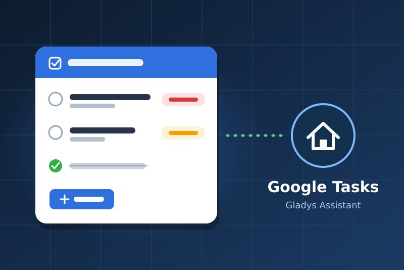
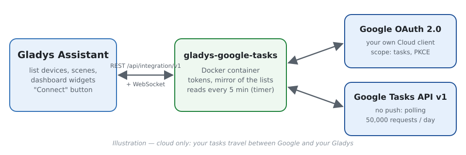
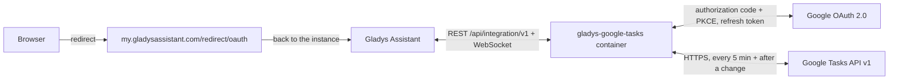
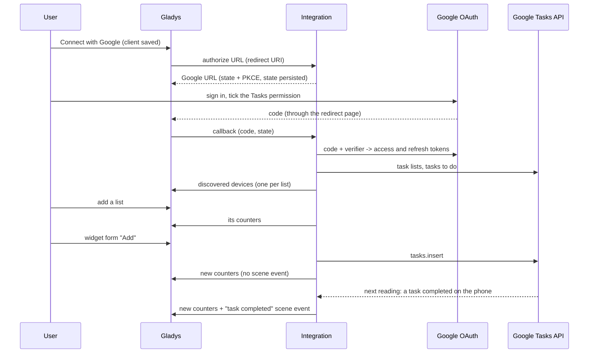
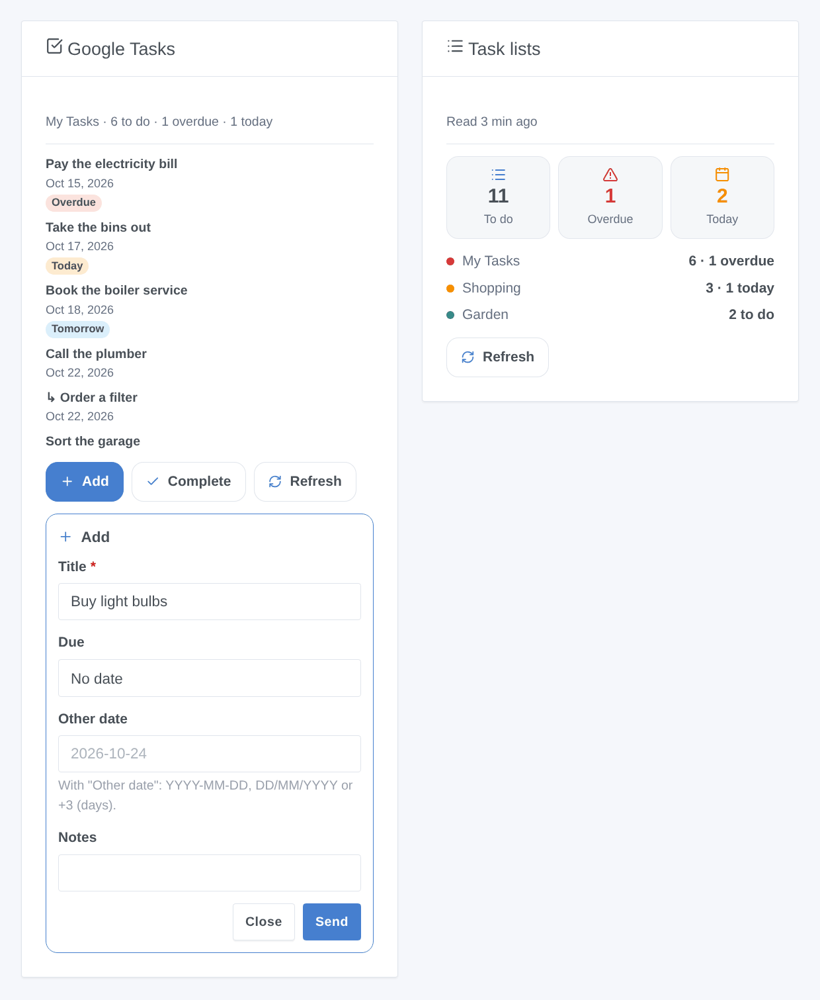

# Gladys Google Tasks

**English** · [Français](README.fr.md) · [Deutsch](README.de.md) · [Español](README.es.md)

[](LICENSE)
[](https://github.com/William-De71/gladys-google-tasks/releases)
[](https://github.com/William-De71/gladys-google-tasks/actions/workflows/release.yml)
[](https://gladysassistant.com)



[Gladys Assistant](https://gladysassistant.com) external integration for **Google Tasks**: your task lists become devices with counters, a dashboard widget lists the tasks and lets you add or complete one, and scenes react to new, completed, due or overdue tasks. It uses the official Google Tasks API with your own Google Cloud OAuth client.

User documentation: [English](docs/en.md) · [Français](docs/fr.md) · [Deutsch](docs/de.md) · [Español](docs/es.md).

> Community integration, not affiliated with nor endorsed by Google.

## Features

- A **device per task list** with three read-only counters: tasks to do, overdue tasks, tasks due today (in the time zone of Gladys).
- **4 scene triggers**, **4 scene actions** and **2 dashboard widgets** with "Add" and "Complete" forms (below).
- **OAuth 2.0** with your own Google Cloud client: minimal `tasks` scope, PKCE, state kept across a restart, a revoked access reported without hammering Google.
- **Polling** (Google Tasks has no push API): every 5 minutes by default, only the changes since the previous reading, and again right after a change made from Gladys.
- Four languages everywhere: English, French, German, Spanish.

## How it works







### Transport

`transports: ["cloud"]`: everything goes through Google's servers; your tasks travel between Google and your Gladys only. The list devices carry the cloud badge, and an "unreachable" badge once Google revoked the access.

## Devices and features

| Feature         | Category / type              | Value                                  |
| --------------- | ---------------------------- | -------------------------------------- |
| Tasks to do     | `counter-sensor` / `integer` | Tasks not completed, subtasks included |
| Overdue tasks   | `counter-sensor` / `integer` | Tasks to do whose due date has passed  |
| Tasks due today | `counter-sensor` / `integer` | Tasks to do due today                  |

## Scene triggers, actions and widgets



- Triggers (each filtered by list): **task added**, **task completed** (outside Gladys), **task due today** (at a configurable hour: Google stores no time), **task overdue** (after midnight).
- Actions: **add a task** (list, title, notes, due date), **complete a task** by its title, **read the tasks** (count, overdue, today, titles, summary, next task), **clear completed tasks**. They never start a scene in return.
- Widgets: **Google Tasks** (the tasks of a list, badges, notes and link, Add / Complete / Refresh) and **Task lists** (totals and one row per list).
- Examples: every morning, read the tasks due today or overdue and send the summary; when a task is added to "Shopping", notify the household; when a task becomes overdue, turn the office LED red.

Not implemented: editing, moving (`tasks.move`) or deleting a task, creating subtasks or lists (a dashboard rarely needs it, and each would add forms for little use); a time on a task (the API only exposes the date).

## Requirements

- Gladys **5.3.0** or later (older versions cannot install the integration: widget forms, widgets and scenes, catalog keywords of Gladys 5.3).
- A Google account using Google Tasks.
- A free Google Cloud project with the Google Tasks API enabled, a consent screen **In production** and an OAuth client of type **Web application** whose redirect URI is `https://my.gladysassistant.com/redirect/oauth` (step by step in the [documentation](docs/en.md#configuration)).

## Installation

- **From the store**: Integrations → Google Tasks → Install.
- **From the repository URL**: Integrations → Add an external integration → `https://github.com/William-De71/gladys-google-tasks`.
- **Developer mode**: `npm install`, then run it next to a Gladys in developer mode with the variables below.

## Configuration

| Field                             | Default   | Purpose                                            |
| --------------------------------- | --------- | -------------------------------------------------- |
| Client ID                         | —         | Your OAuth client (`….apps.googleusercontent.com`) |
| Client secret                     | —         | Its secret (`GOCSPX-…`)                            |
| Connect with Google               | —         | OAuth 2.0 sign-in (`tasks` scope only)             |
| Read Google Tasks every (minutes) | 5         | 1 to 60; 1 request + 1 per list each time          |
| Hour of the "task due" trigger    | 8         | 0 to 23                                            |
| Language of the texts             | Automatic | Feature names, scene summaries                     |

Configuration actions: **Test the connection**, **Read the lists again**, **Diagnostic** (an anonymized summary in the logs), **Disconnect** (revokes the access at Google).

## Usage

Save the Client ID and secret, click **Connect with Google**, accept the "unverified app" warning (it is your own app) and tick the Tasks permission, then add the lists from **Discovery** and the widgets to a dashboard.

## Development

```bash
npm install
npm test                     # node --test, never touches the network
npm run lint && npm run format:check
npx github:GladysAssistant/integration-store . --skip-image-check
docs/illustrations/render.sh # widget illustrations
scripts/build-cover.sh       # cover.jpg
```

Environment variables (set by the Gladys supervisor): `GLADYS_HOST_API_URL`, `GLADYS_INTEGRATION_TOKEN`, `GLADYS_INTEGRATION_SELECTOR`, and `TZ` (the time zone of Gladys: "today" and "overdue" follow it). The integration writes nothing to `/data`: the tokens live in the Gladys configuration.

## Release process


Every merge on `main` runs the CI, then computes the version from the [Conventional Commits](https://www.conventionalcommits.org/) since the last tag: `feat` → minor, `fix` / `perf` → patch, `!` or `BREAKING CHANGE` → major (a minor below 1.0.0); `docs`, `chore`, `ci`, `test`, `style`, `refactor`, `build` alone publish nothing. With no tag yet, 0.1.0 is released as is. The changelog section is generated, the tag pushed, the multi-architecture image built, then `main` receives the release commit (so the store never sees a version without its image), the GitHub Release is created and a last job checks the public image, the store validator and the topic.

- The pull request title becomes the squash commit, then the changelog line: write it in English, for the user (`pr-title.yml` checks it). Never edit `CHANGELOG.md` by hand.
- 1.0.0 is a decision: Actions → Release → Run workflow with `release-as: 1.0.0`. `dry-run` shows the version and the notes without publishing.
- **Protected branch**: the release pushes its commit to `main` with `GITHUB_TOKEN`. With a ruleset on `main`, add GitHub Actions to its bypass list (or push through a GitHub App), otherwise the publish job fails.
- After the first release, the `ghcr.io` package must be public (Package settings → Change visibility).

## Troubleshooting

See [docs/en.md](docs/en.md#troubleshooting) (redirect URI mismatch, app left in Testing, permission not ticked, API not enabled, time zone). Report issues with the versions of Gladys and of the integration, your Google Cloud setup, and the output of the **Diagnostic** button (Settings → Supervision).

## Contributing

Issues and pull requests are welcome. Run `npm run format:check && npm run lint && npm test` before opening a pull request, and keep every external id and stored key unchanged (see [CLAUDE.md](CLAUDE.md)).

## Security

See [SECURITY.md](SECURITY.md): report vulnerabilities privately. The Client secret is a `secret` field; the tokens live in the Gladys configuration (outside the form) and are never logged; the Diagnostic action writes neither tokens nor task titles.

## Screenshots to come

The images above are illustrations, not screenshots. Real screenshots will go in `docs/assets/screenshots/` (PNG, 1280 × 800): `configuration.png`, `google-consent.png`, `discovery.png`, `device.png`.

## License

[Apache License 2.0](LICENSE) — see also [NOTICE](NOTICE). Google Tasks is a trademark of Google LLC; this community integration is not affiliated with it. Thanks to the Gladys documentation and SDK.
